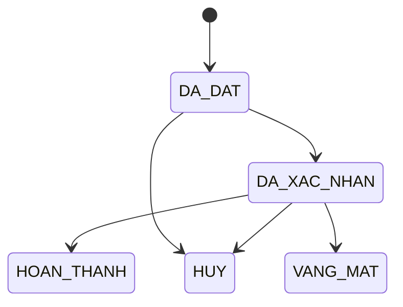

# T03 – Báo cáo khảo sát mảng B: Bệnh nhân & Lịch hẹn

| | |
|---|---|
| Mã việc | T03 (GĐ0, tuần 1) |
| Người thực hiện / review | Lê Ngọc Khôi / Nguyễn Đăng Khoa |
| Ngày | 08/10/2026; cập nhật 19/10/2026 theo phạm vi đã chốt; 21/10/2026 tách quản trị theo 3 mảng |
| Chuẩn tham chiếu | ISO/IEC/IEEE 29148:2018 – thu thập và phân tích yêu cầu |
| Dùng cho | T08 (BR-B), T12 (ERD mảng B) |

## 1. Thông tin khảo sát

| Mục | Nội dung |
|---|---|
| Mục tiêu | Xác định dữ liệu, trạng thái và quy tắc cần lưu cho việc đặt và quản lý lịch hẹn khám, đủ cho một CSDL đồ án môn học |
| Phạm vi | Bệnh nhân, lịch hẹn khám trực tiếp / tư vấn từ xa, giấy chuyển chuyên khoa nội bộ, phí khám, tài khoản đăng nhập theo vai trò |
| Ngoài phạm vi | Đăng ký tài khoản trực tuyến, quên mật khẩu, đặt hộ người thân, cuộc gọi video, BHYT |
| Đối tượng khảo sát | Luồng đặt khám của 3 ứng dụng đặt khám phổ biến tại Việt Nam: Medpro, YouMed, BookingCare; quy định về khám bệnh, chữa bệnh từ xa và chuyển người bệnh |
| Phương pháp | Phân tích ứng dụng hiện có (đi qua luồng đặt lịch, ghi lại các trường dữ liệu và trạng thái) và nghiên cứu văn bản pháp lý liên quan. Không phỏng vấn trực tiếp nhân viên y tế |
| Giới hạn | Không mô tả đầy đủ nghiệp vụ y tế thật; quy trình ở mục 3 là phần chung của ba ứng dụng, đã lược bớt chi tiết riêng của từng nơi |

## 2. Bên liên quan

| Bên liên quan | Vai trò trong quy trình | Nhu cầu dữ liệu |
|---|---|---|
| Bệnh nhân | Đặt lịch, khám trực tiếp hoặc tư vấn từ xa | Xem lịch hẹn của mình |
| Lễ tân | Đặt hộ, xác nhận, hủy lịch hẹn | Thêm, sửa bệnh nhân và lịch hẹn; xem lịch làm việc bác sĩ |
| Bác sĩ đa khoa | Khám, lập giấy chuyển chuyên khoa | Xem lịch hẹn của mình; lập giấy chuyển |
| Bác sĩ chuyên khoa | Khám theo chuyên khoa khi có giấy chuyển hoặc tái khám | Xem lịch hẹn của mình |
| Quản trị tài khoản | Cấp, khóa tài khoản nhân viên | Thêm, sửa tài khoản nhân viên |

Mọi tác nhân đăng nhập bằng một tài khoản mang đúng một vai trò; mỗi vai trò chỉ thao tác trên phần dữ liệu ghi ở cột nhu cầu.

## 3. Hiện trạng quy trình

1. **Đặt lịch**: chọn hình thức (trực tiếp / video) → chuyên khoa → bác sĩ → ngày, giờ còn trống trong lịch làm việc của bác sĩ → xem phí khám → nhập thông tin bệnh nhân, lý do khám. Bệnh nhân tự đặt hoặc lễ tân đặt hộ.
2. **Xác nhận**: lễ tân xác nhận lịch.
3. **Khám trực tiếp**: bệnh nhân đến đúng giờ tại phòng khám, bác sĩ khám. Phần khám, chẩn đoán, kê đơn thuộc **mảng C**.
4. **Tư vấn từ xa**: giống khám trực tiếp, nhưng bệnh nhân vào cuộc gọi qua link vào giờ hẹn.
5. **Chuyển chuyên khoa**: bác sĩ đa khoa thấy cần thì lập giấy chuyển, bệnh nhân dùng giấy đó để đặt lịch chuyên khoa.

Trạng thái lịch hẹn quan sát được:

Lịch hẹn đã hủy hoặc vắng mặt **không chiếm giờ** của bác sĩ.

Quy định và thực tế liên quan:

| Nội dung | Quy định / quan sát | Ảnh hưởng tới CSDL |
|---|---|---|
| Khám chữa bệnh từ xa | Luật Khám bệnh, chữa bệnh 15/2023/QH15 cho phép khám, chữa bệnh từ xa; Thông tư 30/2023/TT-BYT ban hành danh mục 50 bệnh được khám chữa bệnh từ xa, hiệu lực 01/01/2024. Người hành nghề chịu trách nhiệm về chẩn đoán, kê đơn như khám trực tiếp | Tư vấn từ xa là một hình thức của lịch hẹn; lần khám, chẩn đoán, đơn thuốc dùng chung với khám trực tiếp. Không kiểm tra bệnh có thuộc danh mục |
| Phiếu khám điện tử | Medpro: sau khi đặt, bệnh nhân nhận phiếu khám điện tử có giờ khám dự kiến và số thứ tự; hôm khám trình phiếu cho nhân viên để xác nhận | Lịch hẹn lưu khoảng giờ hẹn; không cấp số thứ tự |
| Chuyển người bệnh | Từ 01/7/2025, Luật BHYT sửa đổi (51/2024/QH15) thay "chuyển tuyến" bằng "chuyển người bệnh giữa các cơ sở" | Giấy chuyển chuyên khoa của nhóm chỉ là **quy trình nội bộ trong một phòng khám**, không liên quan BHYT |

## 4. Yêu cầu đối với CSDL

Rút ra từ quy trình ở mục 3 và nhu cầu dữ liệu ở mục 2.

| Nguồn trong quy trình | Yêu cầu |
|---|---|
| Bước 1: chỉ chọn giờ còn trống trong lịch làm việc | Lịch hẹn nằm trong ca của bác sĩ; không trùng lịch khác của bác sĩ hay của bệnh nhân |
| Bước 5: khám chuyên khoa cần giấy chuyển | Lịch chuyên khoa phải kèm giấy chuyển hợp lệ của chính bệnh nhân, trừ tái khám |
| Bước 4: vào cuộc gọi qua link | Tư vấn từ xa bắt buộc có nền tảng, link phiên |
| Sơ đồ trạng thái | Trạng thái chỉ chuyển theo sơ đồ |
| Bước 1: chọn một hình thức | Mỗi lịch hẹn thuộc đúng một hình thức |
| Bước 5: bác sĩ đa khoa lập giấy | Chỉ bác sĩ đa khoa lập giấy; giấy có hạn |
| Mục 2: nhu cầu dữ liệu từng bên | Mỗi vai trò chỉ thao tác đúng phần dữ liệu của mình |
| Mục 2: đăng nhập theo vai trò | Tài khoản bệnh nhân gắn đúng bệnh nhân; tài khoản khác gắn đúng nhân viên cùng loại |
| Bước 1: lễ tân tiếp nhận bệnh nhân | Lễ tân tạo tài khoản bệnh nhân; quản trị tài khoản quản lý tài khoản nhân viên; tài khoản chỉ khóa, không xóa |

## 5. Ràng buộc và giả định

- Giờ hẹn là một khoảng thời gian (bắt đầu, kết thúc), không chia khung giờ cố định.
- Chuyên khoa của lịch hẹn là chuyên khoa của bác sĩ được hẹn, không ghi riêng.
- Tái khám là bệnh nhân đã có lịch hẹn hoàn thành ở cùng chuyên khoa.
- Phí khám gắn với từng lịch hẹn.
- Không cấp số thứ tự khám; mỗi lịch hẹn có khoảng giờ riêng.
- Không kiểm tra bệnh của bệnh nhân có thuộc danh mục được khám từ xa.
- Lễ tân là nhân viên (mảng A), có tài khoản với vai trò lễ tân (thêm, sửa bệnh nhân và lịch hẹn; không xem bệnh án).
- Có 6 vai trò cố định: quản trị nhân sự, quản trị tài khoản, quản trị danh mục, bác sĩ, lễ tân, bệnh nhân; mỗi tài khoản mang đúng một vai trò.
- Quản trị tài khoản tạo tài khoản nhân viên, khóa tài khoản (vai trò theo loại nhân viên, không đổi riêng); lễ tân tạo tài khoản bệnh nhân khi tiếp nhận. Bệnh nhân không tự đăng ký và không bắt buộc có tài khoản (lễ tân đặt hộ).
- Tài khoản đầu tiên (vai trò quản trị tài khoản) có sẵn khi khởi tạo hệ thống. Mật khẩu không lưu ở dạng đọc được.

## 6. Kết quả khảo sát: dữ liệu cần lưu (đầu vào T08, T12)

| Đối tượng | Thông tin cần lưu | Quan hệ với đối tượng khác |
|---|---|---|
| Bệnh nhân | Họ tên, ngày sinh, giới tính, số điện thoại (không trùng), email | Đặt nhiều lịch hẹn; được cấp nhiều giấy chuyển; có tối đa một tài khoản |
| Lịch hẹn | Thời điểm bắt đầu, kết thúc, lý do khám, trạng thái, hình thức, phí khám, ngày tạo. Khám trực tiếp: phòng khám. Tư vấn từ xa: nền tảng, đường dẫn phiên | Của một bệnh nhân với một bác sĩ (mảng A); có thể dùng một giấy chuyển; có tối đa một lần khám (mảng C) |
| Giấy chuyển chuyên khoa | Ngày lập, lý do, ngày hết hạn | Cấp cho một bệnh nhân; do một bác sĩ đa khoa lập; chuyển đến một chuyên khoa (mảng A); dùng cho tối đa một lịch hẹn |
| Tài khoản | Tên đăng nhập, mật khẩu, vai trò, trạng thái (hoạt động, khóa) | Của đúng một bệnh nhân hoặc một nhân viên (mảng A) |

Điểm phân loại cần chú ý ở bước thiết kế: mỗi lịch hẹn thuộc đúng một hình thức, mỗi hình thức có thông tin riêng.

## Nguồn tham khảo

- Medpro – hình thức đặt khám: https://medpro.vn/cho-ray/hinh-thuc-dat-kham ; tư vấn online: https://medpro.vn/tin-tuc/tu-van-suc-khoe-online
- YouMed (App Store): https://apps.apple.com/app/id1466077723
- BookingCare (App Store): https://apps.apple.com/vn/app/id1347700144
- Medpro – đặt lịch khám, lấy số thứ tự: https://medpro.vn/tin-tuc/dat-lich-kham-lay-so-thu-tu-tren-medpro
- Thông tư 30/2023/TT-BYT – danh mục bệnh được khám bệnh, chữa bệnh từ xa: https://vbpl.vn/TW/Lists/vbpq/Attachments/178262/30_2023_TT-BYT_593328.doc
- Luật Khám bệnh, chữa bệnh số 15/2023/QH15: https://thuvienphapluat.vn/van-ban/The-thao-Y-te/Luat-15-2023-QH15-kham-benh-chua-benh-372143.aspx
- Điểm mới về chuyển tuyến BHYT từ 01/7/2025: https://luatvietnam.vn/bao-hiem/3-diem-moi-ve-chuyen-tuyen-bhyt-tu-ngay-01-7-2025-563-100345-article.html
- ISO/IEC/IEEE 29148:2018 – Systems and software engineering — Life cycle processes — Requirements engineering.
