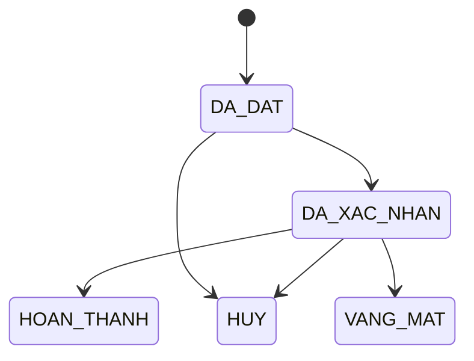

# T03 – Báo cáo khảo sát mảng B: Bệnh nhân & Lịch hẹn

| | |
|---|---|
| Mã việc | T03 (GĐ0, tuần 1) |
| Người thực hiện / review | Lê Ngọc Khôi / Nguyễn Đăng Khoa |
| Ngày | 08/10/2026; cập nhật 19/10/2026 theo phạm vi đã chốt |
| Chuẩn tham chiếu | ISO/IEC/IEEE 29148:2018 – thu thập và phân tích yêu cầu |
| Dùng cho | T08 (BR-B), T12 (ERD mảng B) |

## 1. Thông tin khảo sát

| Mục | Nội dung |
|---|---|
| Mục tiêu | Xác định dữ liệu, trạng thái và quy tắc cần lưu cho việc đặt và quản lý lịch hẹn khám, đủ cho một CSDL đồ án môn học |
| Phạm vi | Bệnh nhân, lịch hẹn khám trực tiếp / tư vấn từ xa, giấy chuyển chuyên khoa nội bộ, phí khám |
| Ngoài phạm vi | Tài khoản đăng nhập, đặt hộ người thân, cuộc gọi video, BHYT |
| Đối tượng khảo sát | Luồng đặt khám của 3 ứng dụng đặt khám phổ biến tại Việt Nam: Medpro, YouMed, BookingCare; quy định về khám bệnh, chữa bệnh từ xa và chuyển người bệnh |
| Phương pháp | Phân tích ứng dụng hiện có (đi qua luồng đặt lịch, ghi lại các trường dữ liệu và trạng thái) và nghiên cứu văn bản pháp lý liên quan. Không phỏng vấn trực tiếp nhân viên y tế |
| Giới hạn | Không mô tả đầy đủ nghiệp vụ y tế thật; quy trình ở mục 3 là phần chung của ba ứng dụng, đã lược bớt chi tiết riêng của từng nơi |

## 2. Bên liên quan

| Bên liên quan | Vai trò trong quy trình | Nhu cầu dữ liệu | Trong ERD |
|---|---|---|---|
| Bệnh nhân | Đặt lịch, khám trực tiếp hoặc tư vấn từ xa | Xem lịch hẹn của mình | Thực thể BENH_NHAN |
| Lễ tân | Đặt hộ, xác nhận, hủy lịch hẹn | Thêm, sửa bệnh nhân và lịch hẹn; xem lịch làm việc bác sĩ | Không – role `r_le_tan` |
| Bác sĩ đa khoa | Khám, lập giấy chuyển chuyên khoa | Xem lịch hẹn của mình; lập giấy chuyển | Thực thể BAC_SI_DA_KHOA (mảng A) |
| Bác sĩ chuyên khoa | Khám theo chuyên khoa khi có giấy chuyển hoặc tái khám | Xem lịch hẹn của mình | Thực thể BAC_SI_CHUYEN_KHOA (mảng A) |

Tác nhân ghi "Không" là người dùng hệ thống: chỉ có role CSDL để phân quyền, không lưu thành thực thể trong ERD.

## 3. Hiện trạng quy trình

1. **Đặt lịch**: chọn hình thức (trực tiếp / video) → chuyên khoa → bác sĩ → ngày, giờ còn trống trong lịch làm việc của bác sĩ → xem phí khám → nhập thông tin bệnh nhân, lý do khám. Bệnh nhân tự đặt hoặc lễ tân đặt hộ.
2. **Xác nhận**: lễ tân xác nhận lịch.
3. **Khám trực tiếp**: bệnh nhân đến đúng giờ tại phòng khám, bác sĩ khám. Phần khám, chẩn đoán, kê đơn thuộc **mảng C**.
4. **Tư vấn từ xa**: giống khám trực tiếp, nhưng bệnh nhân vào cuộc gọi qua link vào giờ hẹn.
5. **Chuyển chuyên khoa**: bác sĩ đa khoa thấy cần thì lập giấy chuyển, bệnh nhân dùng giấy đó để đặt lịch chuyên khoa.

Trạng thái lịch hẹn quan sát được:

Lịch hẹn HUY hoặc VANG_MAT **không chiếm giờ** của bác sĩ.

Quy định và thực tế liên quan:

| Nội dung | Quy định / quan sát | Ảnh hưởng tới CSDL |
|---|---|---|
| Khám chữa bệnh từ xa | Luật Khám bệnh, chữa bệnh 15/2023/QH15 cho phép khám, chữa bệnh từ xa; Thông tư 30/2023/TT-BYT ban hành danh mục 50 bệnh được khám chữa bệnh từ xa, hiệu lực 01/01/2024. Người hành nghề chịu trách nhiệm về chẩn đoán, kê đơn như khám trực tiếp | Tư vấn từ xa là một hình thức của lịch hẹn; lần khám, chẩn đoán, đơn thuốc dùng chung với khám trực tiếp. Không kiểm tra bệnh có thuộc danh mục |
| Phiếu khám điện tử | Medpro: sau khi đặt, bệnh nhân nhận phiếu khám điện tử có giờ khám dự kiến và số thứ tự; hôm khám trình phiếu cho nhân viên để xác nhận | Lịch hẹn lưu khoảng giờ hẹn; không cấp số thứ tự |
| Chuyển người bệnh | Từ 01/7/2025, Luật BHYT sửa đổi (51/2024/QH15) thay "chuyển tuyến" bằng "chuyển người bệnh giữa các cơ sở" | Giấy chuyển chuyên khoa của nhóm chỉ là **quy trình nội bộ trong một phòng khám**, không liên quan BHYT |

## 4. Yêu cầu đối với CSDL

Rút ra từ quy trình; phát biểu chính thức, đánh số và cách kiểm chứng ở [T08](../br/T08_BR_MangB.md).

| Nguồn trong quy trình | Yêu cầu | Quy tắc |
|---|---|---|
| Bước 1: chỉ chọn giờ còn trống trong lịch làm việc | Lịch hẹn nằm trong ca của bác sĩ; không trùng lịch khác của bác sĩ hay của bệnh nhân | BR-B01, BR-B02 |
| Bước 5: khám chuyên khoa cần giấy chuyển | Lịch chuyên khoa phải kèm giấy chuyển hợp lệ của chính bệnh nhân, trừ tái khám | BR-B03 |
| Bước 4: vào cuộc gọi qua link | Tư vấn từ xa bắt buộc có nền tảng, link phiên | BR-B04 |
| Sơ đồ trạng thái | Trạng thái chỉ chuyển theo sơ đồ | BR-B05 |
| Bước 1: chọn một hình thức | Mỗi lịch hẹn thuộc đúng một hình thức | BR-B06 |
| Bước 5: bác sĩ đa khoa lập giấy | Chỉ bác sĩ đa khoa lập giấy; giấy có hạn | BR-B07 |

## 5. Ràng buộc và giả định

- Giờ hẹn lưu dạng khoảng thời gian (bắt đầu, kết thúc), không dùng bảng khung giờ cố định.
- Chuyên khoa của lịch hẹn lấy qua bác sĩ, không lưu riêng.
- Tái khám là bệnh nhân đã có lịch hẹn HOAN_THANH ở cùng chuyên khoa.
- Phí khám là một thuộc tính của lịch hẹn.
- Không cấp số thứ tự khám; mỗi lịch hẹn có khoảng giờ riêng.
- Không kiểm tra bệnh của bệnh nhân có thuộc danh mục được khám từ xa.
- Lễ tân là người dùng hệ thống, không phải thực thể: chỉ có role CSDL `r_le_tan` (thêm, sửa bệnh nhân và lịch hẹn; không xem bệnh án).

## 6. Kết quả khảo sát (đầu vào T12)

| Thực thể | Thuộc tính chính | Liên kết |
|---|---|---|
| BENH_NHAN | ma_bn, ho_ten, ngay_sinh, gioi_tinh, sdt (UNIQUE), email | 1:N LICH_HEN |
| LICH_HEN (lớp cha) | ma_lh, thoi_gian_bd, thoi_gian_kt, ly_do_kham, trang_thai, hinh_thuc, phi_kham, ngay_tao | N:1 BENH_NHAN, BAC_SI (A); 1:1 LAN_KHAM (C) |
| KHAM_TRUC_TIEP (lớp con) | phong_kham | ISA LICH_HEN |
| TU_VAN_TU_XA (lớp con) | nen_tang, link_phien | ISA LICH_HEN; thời lượng tính từ giờ bắt đầu, kết thúc của lịch hẹn |
| GIAY_CHUYEN_KHOA | ma_giay, ngay_lap, ly_do, ngay_het_han | N:1 BENH_NHAN, BAC_SI_DA_KHOA (A), CHUYEN_KHOA (A); 0..1 LICH_HEN dùng giấy |

Các liên kết:

| Liên kết | Thực thể tham gia | Tỉ số | Thuộc tính |
|---|---|---|---|
| ĐẶT | BENH_NHAN – LICH_HEN | 1:N | – |
| PHỤ_TRÁCH | BAC_SI (A) – LICH_HEN | 1:N | – |
| ĐƯỢC_CẤP | BENH_NHAN – GIAY_CHUYEN_KHOA | 1:N | – |
| LẬP_GIẤY | BAC_SI_DA_KHOA (A) – GIAY_CHUYEN_KHOA | 1:N | – |
| CHUYỂN_ĐẾN | CHUYEN_KHOA (A) – GIAY_CHUYEN_KHOA | 1:N | – |
| SỬ_DỤNG | GIAY_CHUYEN_KHOA – LICH_HEN | 1:1 | – |

Phân lớp LICH_HEN → {KHAM_TRUC_TIEP, TU_VAN_TU_XA}: mỗi lịch hẹn thuộc **đúng một** lớp con. Đây là điểm EER của mảng B.

## Nguồn tham khảo

- Medpro – hình thức đặt khám: https://medpro.vn/cho-ray/hinh-thuc-dat-kham ; tư vấn online: https://medpro.vn/tin-tuc/tu-van-suc-khoe-online
- YouMed (App Store): https://apps.apple.com/app/id1466077723
- BookingCare (App Store): https://apps.apple.com/vn/app/id1347700144
- Medpro – đặt lịch khám, lấy số thứ tự: https://medpro.vn/tin-tuc/dat-lich-kham-lay-so-thu-tu-tren-medpro
- Thông tư 30/2023/TT-BYT – danh mục bệnh được khám bệnh, chữa bệnh từ xa: https://vbpl.vn/TW/Lists/vbpq/Attachments/178262/30_2023_TT-BYT_593328.doc
- Luật Khám bệnh, chữa bệnh số 15/2023/QH15: https://thuvienphapluat.vn/van-ban/The-thao-Y-te/Luat-15-2023-QH15-kham-benh-chua-benh-372143.aspx
- Điểm mới về chuyển tuyến BHYT từ 01/7/2025: https://luatvietnam.vn/bao-hiem/3-diem-moi-ve-chuyen-tuyen-bhyt-tu-ngay-01-7-2025-563-100345-article.html
- ISO/IEC/IEEE 29148:2018 – Systems and software engineering — Life cycle processes — Requirements engineering.
